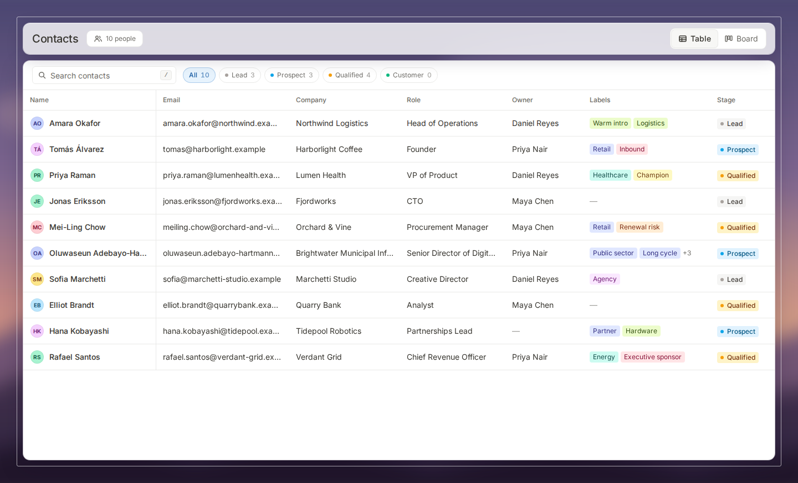
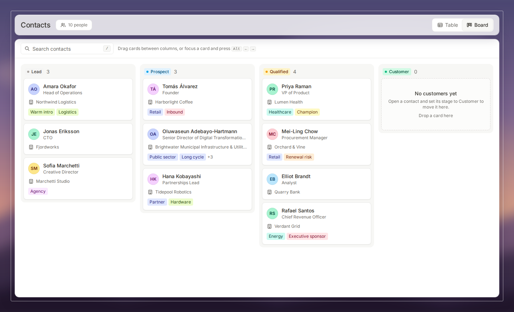
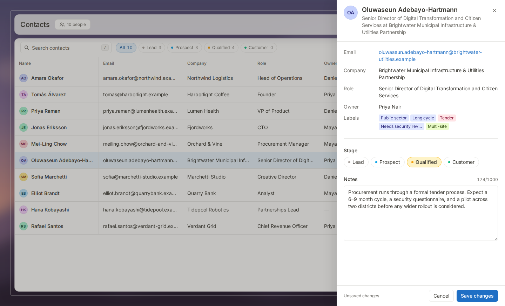

# Contact board: one dataset, two synchronized views

A Notion-style contact manager prototype built with **React 18, TypeScript (strict), Vite and
Tailwind CSS**. Ten fictional contacts can be scanned as a **table** or organised on a **board**
by stage. Either view opens the same slide-over panel to edit **Stage** and **Notes** with an
explicit **Save changes / Cancel** flow. No backend, no state libraries.

| Table | Board | Details panel |
| :---: | :---: | :---: |
|  |  |  |

## Run it

```bash
npm install
npm run dev        # http://localhost:5173
npm test           # 12 unit tests (state, filtering, sorting)
npm run build      # type-check + production build
```

An optional Playwright smoke test (29 checks: edit/cancel/sync, drag, undo, focus, narrow
layout) is in `scripts/e2e_smoke.py`.

## Brief → where it is covered

| Requirement | Implementation |
| --- | --- |
| 8–12 contacts, all 8 fields | `data/contacts.ts`: 10 records, deliberately uneven |
| Table / Board switch | `ViewSwitcher` (accessible tablist), choice also remembered across reloads |
| Table: people as rows, fields as columns | `TableView`: all 8 fields, sticky header + pinned Name column |
| Board: Lead, Prospect, Qualified, Customer | `BoardView` derives columns from the same array |
| Edit Stage and Notes from either view | One shared `DetailsPanel`, opened from a row or a card |
| Clear save and cancel | Draft in panel; **Save changes** (disabled until dirty) and **Cancel**; "Unsaved changes" label |
| Saved stage change moves the card, updates table | Single store; board is a projection of it |
| No duplicate or stale records | One array, replace-by-id, selection stored as an id (unit-tested over 40 repeated edits and view switches) |
| Empty board group | *Customer* starts empty, with a drop-here empty state |
| Missing optional information | Missing notes, labels, owner render as a muted dash plus screen-reader text |
| Preserve view when closing the panel | Panel is an overlay; view and scroll container never unmount; per-view scroll memory |
| Sensible keyboard focus | Focus trap, Esc, focus returns to the opener (even if its card changed column), visible focus rings |
| Usable narrower desktop layout | Down to ~700px: table scrolls with Name pinned; board scrolls horizontally |
| Drag-and-drop *(optional)* | Native HTML5 DnD **plus** a keyboard equivalent (Alt + ←/→) |
| Search, filters *(optional)* | Search across every field; stage chips with live counts; sortable columns |

## Standout extras (beyond the brief)

- **Undo.** Every stage change (save, drag, keyboard move) shows a toast with *Undo*, so a mis-drop is one click from recovery.
- **Search, stage filters, sorting.** Multi-term search over all fields including labels and notes, `/` to focus it, Esc to clear. Chips show counts that respect the current search. Click a header to sort ascending, descending, then off; blanks always sort last. `aria-sort` is set.
- **Accessible drag-and-drop.** Pointer drag between columns; keyboard users focus a card and press **Alt + ←/→**, and focus follows the card to its new column. The panel remains the third path.
- **Spreadsheet keyboard feel.** Up/Down arrows move between rows in the table.
- **Honest empty and no-result states** with a *Clear search and filters* action, and a per-view error boundary so a render failure is recoverable.
- **Visual polish.** Blurred backdrop with an inset frame and frosted header (replace `public/backdrop.svg` with any photo to restyle), self-hosted Inter, tinted stage/label chips, `prefers-reduced-motion` respected.
- **Tests.** The reducer and selectors are pure and covered by Vitest, including repeated edits and view switches.

## Structure

```
src/
  types/contact.ts          Contact, Stage, ViewMode, ContactPatch, SortState
  data/contacts.ts          seed data;  data/stages.ts  stage order, colours, empty-state copy
  hooks/contactsReducer.ts  pure reducer + state shape (unit-tested)
  hooks/useContacts.tsx     context provider: stable action callbacks
  hooks/useFocusTrap.ts     Tab trap, Esc, focus return
  hooks/useScrollMemory.ts  per-view scroll offsets
  lib/                      filterContacts (search + sort), groupByStage, text, colours
  components/               TableView, BoardView, BoardColumn, ContactCard, DetailsPanel,
                            Toolbar, ViewSwitcher, Toast, StageBadge, LabelList, Avatar, Empty,
                            NoResults, ErrorBoundary, icons
```

## State synchronization strategy

1. **One array, two projections.** `contacts` lives in one `useReducer` store. The table runs
   `selectContacts(...)` over it; the board runs the same selector and then `groupByStage`. No
   per-view or per-column copies exist, so there is nothing to drift out of sync.
2. **Reducer, not closures.** Components receive stable callbacks that only `dispatch`. The reducer
   always reads the latest state, which removes the stale-closure class of bugs for repeated edits.
3. **Selection is an id.** The panel's record is looked up from `contacts` on every render, so it
   can never show an outdated copy. Unknown ids are ignored.
4. **Drafts are local.** `DetailsPanel` is keyed by contact id and keeps `stage` and `notes` in its
   own `useState`. Save dispatches one action and closes. Cancel, X, Esc and backdrop just unmount
   it, which discards the draft. Notes are trimmed on save; blank becomes "no notes".
5. **Stable layout.** Saves replace a record in place (same array position), so table rows never
   jump. Table columns are fixed-width with truncation, so long values never reflow rows.
6. **Undo is a snapshot.** The pre-change record is stored on the notice and restored by id.

## Design decisions

- **Hierarchy:** one frosted header carries identity (title, count, view switch). A single white
  sheet holds search/filters and the data, so the eye lands on the data.
- **Table** shows all eight fields (scanning is its job). **Cards** show only what you decide with:
  name, role, company, labels. Email, owner and notes live in the panel to keep cards compact.
- **Panel** order: read-only context first, editable fields after a divider, actions pinned in a footer.
- **Colour is never the only signal:** stage chips always carry the stage name; blanks carry text.

## Accessibility

Dialog semantics (`role="dialog"`, `aria-modal`, labelled), focus moved in and returned, Tab trapped,
background `inert`; tablist with roving tabindex; table caption, `scope`, `aria-sort`; stage as a real
radio group; polite live region announcing moves and undos; `focus-visible` rings throughout;
motion wrapped in `motion-safe`.

## Trade-offs I accepted

- **Closing discards edits silently**, as specified. A confirm-on-dirty-close would be safer for long notes.
- **Everything re-renders from the full array.** Fine for hundreds of contacts; thousands would need
  memoised rows or virtualisation.
- **Hand-rolled focus trap** to keep the dependency list at React. Radix or similar would handle more
  exotic cases (nested portals, iframes).
- **Native HTML5 drag-and-drop** has no touch support and a basic drag preview. The keyboard path and
  the panel cover accessibility; touch would need pointer events or a library such as dnd-kit.
- **Only the view choice is persisted** (localStorage, guarded). Contact edits reset on reload, since
  the brief asked for local state.
- **Board ignores the stage filter chips** (they are hidden in board view): the columns already are
  the stage filter. Search applies to both.
- **Backdrop is a generated SVG**, not a photograph, so the repo stays self-contained.

## Not done / next steps

- Manual column reordering inside a column and drop-position indicators.
- Editing other fields, creating and deleting contacts.
- Persisting contacts (localStorage or an API) with optimistic updates and rollback.
- Touch drag-and-drop; a stacked single-column board below ~700px.
- Column show/hide and resize; saved views.
- Visual regression tests; the Playwright smoke script is not wired into CI.
